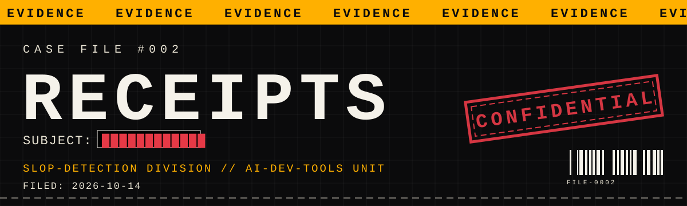

[](https://github.com/dwijmistry266-ship-it/receipts)
[](https://github.com/dwijmistry266-ship-it/receipts/actions)
[](https://pypi.org/project/receipts-py/)
[](https://www.python.org/)
[](LICENSE)

Your agent said "fixed, tests pass."
receipts checks every claim against the evidence.
Receipts or it didn't happen.

---

**CASE FILE #002 — CLAIM VERIFICATION DIVISION**

The #1 pain of the agent era is the **false done**. Your agent reports
"fixed, all 84 tests pass" — but the file was never touched, the tests
never ran, the count came from nowhere. receipts takes the agent's summary
and cross-checks every verifiable claim against hard evidence: git diffs,
the working tree, and the session transcript. Deterministic. No LLM. No
vibes.

```
$ receipts verify "Fixed auth.py, 84 tests pass." --session

RECEIPTS — claim verification
repo: /home/user/myproject
session: /home/user/.claude/projects/abc123.jsonl

✅ [file] auth.py
    └─ in git diff (modified)
✅ [tests ran] python -m pytest tests/ -q
    └─ executed in session, exit code 0
✅ [test count] 84/84
    └─ session output confirms 84 passed

verdict: VERIFIED  (3 passed, 0 warnings, 0 failed of 3 claims)
```

And when the agent is bluffing:

```
❌ [file] ghost_module.py
    └─ phantom file — not in diff, tree, or disk
❌ [test count] 84/84
    └─ claimed 84 passed, session shows 79

verdict: FAILED  (0 passed, 0 warnings, 2 failed of 2 claims)
Receipts or it didn't happen.
```

## Installation

```bash
pip install receipts-py
```

Zero dependencies. Python 3.9+. The console command is `receipts`.

## Usage

```bash
# Pass the summary as an argument, a file, or stdin
receipts verify "Fixed auth.py, 84 tests pass." --session
receipts verify --summary-file SUMMARY.md --session
echo "$AGENT_SUMMARY" | receipts verify --session

# Point at a specific session file, or let receipts find the latest one
receipts verify "$SUMMARY" --session ~/.claude/projects/abc.jsonl
receipts verify "$SUMMARY" --session        # auto-discover

# Machine-readable output + CI gate
receipts verify "$SUMMARY" --session --json
receipts verify "$SUMMARY" --session --fail-under 100
```

## What it checks

| Claim in the summary | Evidence | Verdict |
|---|---|---|
| `auth.py` mentioned / created / modified | `git diff`, working tree, disk | ✅ in diff · ⚠️ exists but untracked · ❌ phantom file |
| `pytest` / `npm test` / `go test` / `cargo test` invoked | session transcript | ✅ ran, exit 0 · ⚠️ ran, status unknown · ❌ never ran / exit ≠ 0 |
| "84 tests pass" / "69/69 passing" | parsed test output in session | ✅ count matches, zero failures · ❌ mismatch or failures present |
| "fixed the login bug" | file named in the subject, if any | delegates to the file check, else ⚠️ unverifiable |

Verdicts per claim: **✅ PASS** (confirmed), **⚠️ WARN** (inconclusive —
no evidence trail, treat as unproven), **❌ FAIL** (contradicted).
Overall: **VERIFIED** / **PARTIAL** / **FAILED**. Exit code is 1 on FAILED,
or when the pass rate drops below `--fail-under`.

## Session transcripts

receipts reads a canonical JSONL session format:

```json
{"type": "command", "command": "python -m pytest tests/ -q", "exit_code": 0, "output": "84 passed in 1.2s"}
```

It also best-effort parses **Claude Code** (`~/.claude/projects/*.jsonl`,
Bash tool calls + results) and **Codex** (`~/.codex/sessions/*.jsonl`)
sessions. Exit codes it can't see become ⚠️, never ✅ — receipts would
rather warn than bless.

## CI usage

```yaml
- run: pip install receipts-py
- run: receipts verify "$AGENT_SUMMARY" --session --fail-under 100
```

## Agent skill

Agents can self-verify before reporting done. The skill lives at
[`receipts/skill.md`](receipts/skill.md) and is written for Claude Code,
Codex, and Cursor:

> Run receipts at the end of any coding task, before you tell the user
> "fixed, tests pass". A FAILED verdict means: don't report done yet —
> go produce the missing evidence.

## How it works

1. **Extract** — regex-based, deterministic claim extraction. File paths,
   test commands, "N tests pass" counts, "fixed X" statements. Same input,
   same claims, every time.
2. **Gather** — `git diff` (staged + unstaged vs `--diff` base), the
   working tree, and the session transcript.
3. **Verify** — each claim against the evidence. Conservative by design:
   a warning beats a false pass.

## Honest limits

receipts verifies *that* things happened, not *that they were correct*.
A test suite can pass and still be wrong. "Fixed the bug" with no named
file or test is unverifiable by design — name the file, name the test,
keep the receipts.

---

*CASE FILE #002 · CLAIM-VERIFICATION DIVISION · SLOP-DETECTION DIVISION // AI-DEV-TOOLS UNIT*
*FILED: 2026-10-14 · MIT License*
